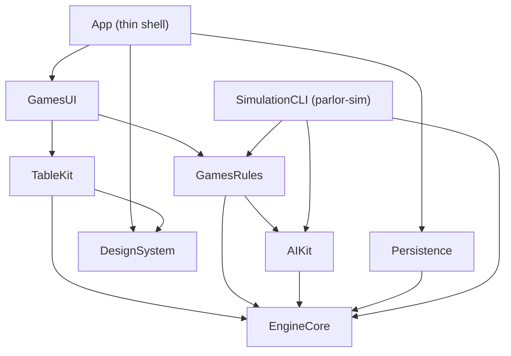

# Parlor — Architecture Overview

This is the living architecture document for Parlor. It is authoritative for how the codebase is
organized and how the pieces fit together; it is kept in sync with behavior changes in the same task that
makes them (`structure.md`; requirement R-NFR-DOC.1). The full design rationale for the current foundation
lives in `/.kiro/specs/01-platform-foundation/design.md`. This revision was checked against the code at
foundation sign-off (task 8.5); places where the code differs from the design are called out in
[Known gaps](#known-gaps-at-foundation-sign-off).

## Guiding principles

Parlor is a premium, fully offline collection of classic card and tile games for macOS. The architecture
exists to serve four things, in priority order (`product.md`): correct rules, fair play, offline privacy,
and delightful-but-legible presentation — while being **multiplayer-ready but single-player now**.

## Layered module map

Dependencies point downward. The direction is declared in the root `Package.swift` and enforced by
`Scripts/lint.sh` (`structure.md`; R-BUILD-1.4).

- **One root SwiftPM package** (`Package.swift`) declares every target, with sources under `Packages/`.
  Swift 6 language mode, strict concurrency, and `-warnings-as-errors` apply to all targets (R-BUILD-5).
  The macOS app target is defined only in `project.yml` (XcodeGen), because SwiftPM cannot build a signed
  `.app`.
- **EngineCore, AIKit, and GamesRules are pure** — Swift standard library and Foundation only — so the
  same rules can run on a future Linux server (`tech.md` rule 1). `make lint` fails on any UI-framework
  import in them.
- **GamesRules and GamesUI are umbrella targets.** Each game is a folder inside them
  (`GamesRules/Klondike/`, `GamesRules/CrazyEights/` with an `AI/` subfolder,
  `GamesRules/Catalog/`; `GamesUI/<Game>TableAdapter|Controller|Layout.swift`). Later families can split
  into their own targets.
- **TableKit** consumes only EngineCore **views and events**, never authoritative state.
- **App** is a thin SwiftUI shell (library, setup sheet, table screens, settings, About, first-run tour).
  The logic lives in packages, so `swift build` and `swift test` run headless.

## Core concepts

- **Host-authoritative.** The `GameHost` actor is the only mutator of game state. It owns the RNG and
  the `ActionLog` (one `LogEntry` per accepted action, with its `StateHash`).
  `submit(ActionEnvelope)` returns a `ResultEnvelope` (accepted + events, or rejected + `RuleViolation`)
  (`tech.md` rule 2; R-SESS-1).
- **Views, not state.** Each client gets a `PlayerView` redacted for its `Viewer` (seat, spectator, or
  debug-only omniscient). Redaction (`Redaction.zoneViews`) is derived from zone `Visibility` plus
  per-piece face-up state. Hidden pieces become `ViewToken`s from a `ViewTokenizer` keyed by viewer and a
  game-supplied salt (SHA-256 of salt, viewer, piece), so they cannot be correlated across viewers.
  Crazy Eights derives its salt from the state. Klondike uses a fixed salt so a face-down card keeps the
  same token between views and animates smoothly; it is single-seat, so nothing leaks. A `pieceRevealed`
  event binds a token to its identity (`tech.md` rule 3; R-ENG-8).
- **Determinism.** xoshiro256\*\* seeded by SplitMix64, our own Fisher–Yates, one recorded seed per hand,
  and a pure-Swift SHA-256 over a canonical encoding. The same seed plus the same log gives the same final
  hash (`tech.md` rule 5; ADR 0002).
- **Codable boundary.** `ActionEnvelope`, `ResultEnvelope`, `ClientMessage`, `HostMessage`, `PlayerView`,
  `GameEvent`, `RuleViolation`, and options are `Codable & Sendable` and schema-versioned (`tech.md`
  rule 4; R-ENG-8.5). `InProcessTransport` carries `ClientMessage` → `HostMessage` to a host.
- **Async controllers and turn models.** `PlayerController.decide(view:seat:)` is async.
  `LocalHumanController` (an actor fed by the UI) and `AIController` (wraps an async strategy) conform.
  `TurnCoordinator` runs sequential, simultaneous (concurrent `TaskGroup`, then batch submit), and
  out-of-turn models, each with an optional `TurnTimeout` (default `.none`). It advances state only via
  `ClientMessage.submit`, so a future `RemoteController` is a new `Transport`, not a rewrite (`tech.md`
  rule 6; R-SESS-2, R-SESS-3; design.md §2.9).
- **No singletons.** Every window builds its own `AutosaveSession` and `GameHost`; `parlor-sim` builds its
  own hosts. Two sessions can run at once (R-SESS-6).
- **Games plug in.** A game is a `GameDefinition` + AI strategies + a table layout/adapter + a rules
  document + a catalog entry. If a game needs EngineCore/TableKit changes, that is an architecture smell
  and requires an ADR (`tech.md` rule 9).

## How an action flows (as built)

1. The table (TableKit `TableInteractionView`) turns a drag, click, double-click, or key press into a
   game action through the game's `GamesUI` adapter/controller, which asks the rules for legal targets.
2. The controller calls the App-supplied `submit` closure, which wraps the action in an `ActionEnvelope`
   and calls `AutosaveSession.submit` (Persistence).
3. `AutosaveSession` forwards to `GameHost.submit`. The host validates with `GameDefinition.apply`,
   appends a `LogEntry`, and returns the events. On acceptance the session writes the `SaveDocument`
   (R-PERS-1.1).
4. Events drive `TableRenderModel` + `AnimationDriver`/`AnimationQueue` (motion), the caption bar and
   history drawer (`HUDModel`), and VoiceOver announcements (`AccessibilityAnnouncer`). A rejection
   springs the card back and captions the `RuleViolation` reason (R-TABLE-4.1).
5. For Crazy Eights, the App's view-model then runs the AI seat. It fetches the AI's redacted view from
   the session, asks a `CrazyEightsAITier` strategy (AIKit `DecisionContext`), and submits through the
   same path.

## AI (AIKit)

- **Information barrier.** `AIStrategy.decide(_ DecisionContext)` sees only the seat's `PlayerView`, the
  `PublicLog`, its legal actions, an injected `SeededRNG`, and a `Deadline`. There is no path to
  authoritative state (R-AI-1.1).
- **Toolkit.** `DeterminizationSampler` (respects inferred voids), `MonteCarlo`, `ISMCTS`, `Evaluator`,
  `GameSimulation` for rollouts. Budgets live in `DecisionBudget` (Hard 1.0 s, 1.5 s for poker/Tile
  Rummy, Medium 0.25 s, Easy 0.02 s) (R-AI-2, R-AI-3).
- **Tiers, personas, pacing, hints.** `Tiers` / `TierConfig`, `AIPersona` (EngineCore) +
  `PersonaWiring`, `AIPacing` (Instant/Fast/Normal/Relaxed, independent of animation speed), and
  `Hint` (action + plain-language reason) (R-AI-4..6).
- **Crazy Eights.** Easy (random legal, dumps 8s), Medium (hoards 8s, names its longest suit, tracks
  voids), Hard (determinized Monte Carlo with a fixed rollout count for reproducibility, stopping 50 ms
  before its deadline so it stays inside budget).

## Rendering (TableKit, DesignSystem)

SwiftUI-first table with stable piece identity and `matchedGeometryEffect` motion. Vector faces are drawn
by `CardFaceCanvas` and rasterized once per `CardFaceKey` (theme, deck style, face, scale bucket,
appearance) into `CardFaceCache`. Table materials are Metal shaders (`TableMaterials.metal`) applied with
SwiftUI `colorEffect`. SpriteKit is used only for the Klondike win celebration. `PerformanceStressScene`
is the 104-card profiling harness. See **ADR 0001** (including its task 8.3 benchmark addendum and the
8.5 implementation-status check).

DesignSystem holds the semantic color tokens (WCAG 2.2 AA pairings tested), type/spacing/radius/shadow/
motion tokens, four table themes (`TableTheme.all`: Classic Felt, Midnight, Walnut Parlor, Minimal),
four deck styles, six card backs, placeholder court-card art, the theme-pack manifest/decoder/registry,
and the event-driven `SoundEngine`.

## Persistence

- **Saves.** `SaveDocument` (schema version 1) records game id, options, match (hand seeds, dealer,
  scores, target), seats, and the action log. Restoring replays the log against the seed through
  `GameHost.restoring`. `SaveMigrator` runs a version-to-version chain. A corrupt, too-new, or
  wrong-game save yields a typed failure; the App shows a non-modal notice and discards it (R-PERS-2).
- **Stores.** `SandboxSaveStore`, `SandboxSettingsStore`, and `SandboxStatisticsStore` write JSON into the
  app's sandbox container, with in-memory twins for tests (R-PERS-3.1).
- **Replay.** `GameReplay` rebuilds a host at the end of a save or at any log prefix (Q-8 is still open on
  scope).
- **Settings and statistics models.** `AppSettings` (appearance, gameplay, sound, accessibility,
  profile), `StatisticsService` (Practice-Mode results skipped, reset requires confirmation), and
  `StatisticsSeries` (chart-ready points).

## Quality gates

- `make test` runs `swift test --enable-code-coverage`, then `Scripts/check-coverage.sh` (≥ 90% line
  coverage for EngineCore, GamesRules, Klondike rules, and Crazy Eights rules incl. AI), then `parlor-sim`
  with 500 games per game per mode (AI-vs-AI and random-legal). `make test-long` runs 10,000.
- `parlor-sim` (`SimulationRunner`) checks piece conservation, only-legal actions, bounded length,
  scoring consistency, and deterministic replay at every step.
- `make lint` runs `swift-format lint --strict` plus `Scripts/lint.sh`: forbidden networking/analytics
  imports and APIs, UI imports in the pure layer, dependency direction, and the entitlement allow-list
  (sandbox only).
- XCUITests live in `UITests/` (full flow, accessibility audits, performance). They run in the Xcode
  project, not in `make test`.

## Determinism and RNG

SplitMix64-seeded xoshiro256\*\* PRNG plus our own Fisher–Yates; one seed recorded per hand; a stable
state hash proves replay determinism. Canonical-encoding rules for hashed state (sorted keys, sorted
sets, dictionaries as sorted entry arrays, no timestamps) are in **ADR 0002**.

## How to add a new game

Adding a game is game-specific code only. Today that means a folder in each umbrella target:

1. `GamesRules/<Game>/` — conform to `GameDefinition` (metadata + stable kebab-case id, options schema +
   presets, initial state from seed, phases, legal actions, `apply` → events or `RuleViolation`,
   terminal/outcome, redaction, undo policy). Keep hashed state canonical (ADR 0002).
2. Add a `DeckDefinition` + composition test if a new composition is needed; supply `CardSemantics` (rank
   order, points, effective suit). Never edit `Card`/`Tile`.
3. `GamesRules/<Game>/AI/` — Easy/Medium/Hard `AIStrategy`s and a hint, using the AIKit toolkit.
4. `GamesUI/` — a declarative table layout plus an adapter/controller that maps the game's view and
   legal actions onto TableKit. No custom animation code.
5. Author `Docs/Rules/<game-id>.md` (original writing); mark uncertain rules NEEDS REVIEW.
6. Register a `CatalogEntry` in `GameCatalog` behind its feature flag, with placeholder tile art flagged
   "needs production art".
7. Add scenario tests per rule/option; add the game to `SimulationGame` in `parlor-sim`; confirm
   view-leak, save/restore, and the coverage gate.
8. Add a tutorial with scripted deals and coach mode reusing the hint interface. (No tutorial framework
   exists yet; the first game that needs one builds it.)
9. Update this document; if any EngineCore/TableKit change was required, write an ADR first.

## Keyboard-only play (R-A11Y-2.1)

Full keyboard play is guaranteed at two layers:

- **Table (TableKit).** `TableInteractionView` owns a `@FocusState` focus over a game-agnostic
  `FocusTopology` (a left→right ring of zones, each with a bottom→top piece stack). Arrow keys move focus
  (`TableFocusModel.next`), space/return select/place a piece, and escape cancels. A bright ring marks the
  focused target — pieces *and* empty piles (an empty zone's slot is resolved by
  `LayoutResolver.zoneAnchorFrame`). Non-drag actions that dragging cannot express — Klondike stock
  draw/recycle, Crazy Eights draw or pass — are host-supplied `ZoneAction`s carried on the
  `TableInteractionInput` seam; `KeyboardActivation.action(for:in:)` resolves which one a focused zone
  activates, keeping TableKit rules-agnostic. Post-move modal choices (naming a suit after playing an 8)
  are modelled by the pure, game-agnostic `ChoicePrompt` (ordered options, arrow-navigable, shortcut keys,
  space/return to commit) with the concrete options supplied by the host from `legalActions`.

- **App shell flows (library / setup / pause / settings).** These screens (`App/Sources/`, built by the
  Xcode project rather than SwiftPM) are composed from standard focusable SwiftUI controls — `Button`,
  `List`, `Picker`, `Toggle`, `Form`, `TextField`, `.sheet` — which are keyboard-reachable via Full
  Keyboard Access and Tab traversal with no custom key handling. No bespoke focus code lives there;
  the only game-specific keyboard logic is the table interaction above. UI-test coverage of end-to-end
  keyboard completion is task 7.4.

## Known gaps at foundation sign-off

Found by the task 8.5 audit (code reading, plus `make build test lint`; not exercised in the running app).
Each is a difference between the code and `design.md`/`requirements.md`. None was fixed in 8.5, which was
docs-only.

- **App bypasses `Transport`.** The App calls `AutosaveSession.submit(ActionEnvelope)` → `GameHost.submit`
  directly. `InProcessTransport` and `ClientMessage`/`HostMessage` are built and tested but unused by the
  App, and `TurnCoordinator` is unused outside tests (R-SESS-4.2, R-SESS-2.4).
- **Crazy Eights in the App seats one AI at Easy.** `LibraryNavigation.dealCrazyEights` always seats the
  human plus one persona at seat 1, and the view-model always uses the Easy tier with an empty public log
  and no pacing delay. The setup sheet can still choose 2–5 players and a difficulty. With more than two
  players, seats 2+ have no driver (R-CE-1.1, R-APP-2.2, R-AI-4).
- **Sound is not wired.** `SoundEngine` and `AVFoundationAudioPlayer` exist and are tested, but nothing in
  the App creates them, and no audio clips ship (R-DS-5.1).
- **Theme packs on disk are not bundled.** `project.yml` does not copy `Assets/ThemePacks/` into the app.
  The App renders the built-in `TableTheme.all` catalog (R-DS-4.1).
- **No statistics screen or Swift Charts UI.** The statistics models and series exist in Persistence, but
  the App has no statistics view and does not record results (R-APP-4).
- **Settings shows only the profile tab.** `AppSettings` models every group, but `ParlorSettingsView`
  edits only the player profile (R-APP-5.1).
- **Klondike option toggles not honored.** The `autoFlip` toggle is not read by the table, `timed` adds
  no score (Q-1), and `vegasCumulative` does not carry a bankroll (Q-2). See `Docs/Rules/klondike.md`.
- **RNG-API ban is not lint-enforced.** See ADR 0002 implementation status.

## Architecture Decision Records

- `Docs/ADR/0001-rendering-approach.md` — rendering approach (SwiftUI-first, caching, shaders, fallback),
  benchmark addendum, implementation status.
- `Docs/ADR/0002-rng-and-determinism.md` — PRNG algorithm, shuffle, seeds, state hashing, canonical
  encoding rules, implementation status.
- `Docs/ADR/0003-trick-taking-core.md` — reusable trick-taking core (Spec 03) and its additive
  EngineCore/TableKit touchpoints; the core is a stable contract reused unchanged by Spec 07.

ADRs are required for new dependencies, changes to the public APIs of EngineCore or TableKit,
rendering-approach changes, and save-format changes (`structure.md`).
